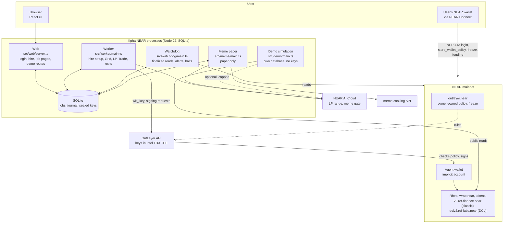

<div align="center">


**4lpha is a hosted DeFi agents marketplace on NEAR mainnet.**

Deposit NEAR, pick an agent, and it trades on Rhea Finance from its own custody wallet, under a spending policy that your NEAR account owns and can freeze.

[Main demo](https://youtu.be/LiskEYE7MjE) · [Hosted demo](https://near.4lpha.tech) · [Strategies](#the-four-strategies) · [Try it with no funds](#try-it-with-no-funds) · [Mainnet evidence](#mainnet-evidence) · [Security](#security-what-the-agents-key-can-and-cannot-do)

<a href="https://youtu.be/LiskEYE7MjE"></a>

Built at **NEAR HACKATHON** (2026-11-01 to 2026-11-14 UTC). Tracks: `defi`, `security`, `agents`.

</div>

---

## What it is and the problem it solves

Running a grid or a concentrated-liquidity position on Rhea means watching the price, placing and claiming orders and moving the range, day and night. Software can do that, but software that can trade from an account can usually also empty it. 4lpha runs each strategy from a separate wallet per agent, under a policy the user owns, and pays funds out only to the user.

- **NEAR in, NEAR plus the token out.** The user deposits only NEAR. The agent swaps into what the strategy needs, and "Stop and withdraw" pays the owner NEAR plus the other token.
- **One OutLayer custody wallet per agent.** Per OutLayer's documentation its key lives inside Intel TDX TEEs; 4lpha holds only the wallet's API key (`wk_...`), sealed in its database.
- **The user owns the policy on chain.** At most 0.25 NEAR per transaction, a daily cap of 3 times the deposit, a whitelist of the owner and the pinned contracts. Only the owner can update, freeze or unfreeze it.
- **Money actions are deterministic and read from receipts.** An LLM may only suggest an LP range, fenced by code. Each submission is classified from all receipt outcomes, so a refunded inner swap counts as failed (FINDINGS 1.4).

---

## The four strategies

Each row links a tutorial video, the public page of an agent that runs with real funds (read-only, no wallet needed) and mainnet transactions.

| Strategy | What it does | Tutorial | Live proof |
|---|---|---|---|
| **Grid** | Native Rhea DCL limit orders on USDC/wNEAR 0.01 %: two or four orders around the price at a 0.45, 0.90, 1.50 or 3.00 % step. After a full fill and a claim, the lane places the reverse order. Optional stop loss and take profit. Deposit 1 to 2 NEAR. | [Video](https://youtu.be/oqsXoihV0O8) | [Agent page](https://near.4lpha.tech/account/ae5fa959-8148-485f-be55-29ea0c6ed157) · [order](https://nearblocks.io/txns/DucP2AeZsFkJztVwZhHZmiua4sYABDSy4AtXHfqi7bBv) · [claim](https://nearblocks.io/txns/AZ7EBoegX6rhNk4qnscyXRspMyYwiit4BsjnieoawPnM) · [reverse](https://nearblocks.io/txns/4nGqV5sY1SfRt3aGBYN2JNLbHVYUQcdLnHcTEVFfyCSR) |
| **LP** | A concentrated position on the same pool, over the owner's price range or about 1 % on each side. Out of range for 5 minutes: remove, rebalance through classic pool 4512 and reopen around the price, at most twice a day. Optional AI range, compound, stop loss and take profit. Deposit 1.2 to 3 NEAR. | [Video](https://youtu.be/1V9U_7v7kc4) | [Agent page](https://near.4lpha.tech/account/5c0fefa2-d820-4591-a625-be77dca4e61e) · [open](https://nearblocks.io/txns/4fsLDwzSFunY5BwcVkkkSmP1dcEeUK59Zt6ipWfEZ5qp) · [rotation: remove](https://nearblocks.io/txns/57DURJQ5vHyms6mFqgz7rrwkcMaPxQT8FoFoN3WpoVKZ) · [reopen](https://nearblocks.io/txns/61MC5x7N8nR5HgK5ATF2vDxZv4TW1ghGciRa2dydC1fo) |
| **Schedule buy** | Buys a fixed NEAR amount of USDC, RHEA or ZEC on a timer (1 to 24 h) through a pinned Rhea classic pool, for up to 6 days, then pays the owner NEAR plus the token. | [Video](https://youtu.be/DCbxlC-sVyQ) | [Agent page](https://near.4lpha.tech/account/d43b9df5-e919-411f-a44a-9940b98e3a26) · [buy](https://nearblocks.io/txns/DYdjbkPSiARsGaSJuvJaVswdg5mReBgywYThg9cRYtEL) · [paid to owner](https://nearblocks.io/txns/38f9fjtBR4tBYLhkx4mwcdb9PxHxqXSMwxhrLzbDDjad) |
| **Auto DCA** | A base order, up to 8 DCA levels below it and a take profit that sells back to NEAR. A new round starts after each take profit, for up to 30 days. A stop loss ends the job without selling. | [Video](https://youtu.be/PIz6a1rvetw) | TODO(operator): agent page and transactions |

Add-on:

| Add-on | What it does | Proof |
|---|---|---|
| **Meme paper agent (beta)** | Watches meme.cooking auctions and joins on paper with live data: deterministic screens plus a NEAR AI gate. No wallet, no deposit, nothing signed. | [`src/core/meme-paper.ts`](src/core/meme-paper.ts) · [`src/core/meme-ask.ts`](src/core/meme-ask.ts) |

Every live agent ends the same way: "Stop and withdraw" exits DCL if needed, then sends NEAR and the other token to the owner only. Bounds are enforced in `src/core/hire.ts`, `grid-settings.ts`, `lp-settings.ts`, `trade-settings.ts` and `pins.ts`.

---

## Hiring an agent, step by step

1. **Pick a strategy:** open [Deploy](https://near.4lpha.tech/deploy/grid), switch to **Live** and choose Grid, LP, Schedule buy or Auto DCA. Set the deposit and limits.
2. **Sign in:** connect a NEAR wallet (NEAR Connect) and sign a free login message.
3. **Sign the policy:** your wallet sends `store_wallet_policy` to `outlayer.near` (about 0.016 NEAR of storage). 4lpha reads it back on chain and stops unless you own it.
4. **Save the management link:** it carries the agent wallet's key and is your exit if 4lpha stops running.
5. **Grid and LP only:** pay the 0.5 NEAR DCL registration for the agent account (DCL cannot refund it).
6. **Fund the agent wallet** with the NEAR deposit. The agent registers its tokens, wraps and swaps on its own.
7. **Watch it work** on the public agent page. Freeze at any time from your wallet; "Stop and withdraw" pays NEAR plus the token back to you only.

Where the funds sit: in your wallet until step 6; then in the agent wallet and in DCL orders or positions owned by the agent account, all shown on the job page; back in your wallet after "Stop and withdraw". If 4lpha is gone, the key in the management link and OutLayer's API recover everything, including value inside DCL (done on mainnet in FINDINGS 1.41). The order of these steps is enforced by `src/core/hire.ts` (tests in `test/hire.test.ts`).

---

## How it fits each track

| Track | What the track asks for | What this project does |
|---|---|---|
| `defi` | Trading agents; a dry run with real data; failed and refunded outcomes shown; funds location at every step | Grid on DCL limit orders, LP on DCL concentrated liquidity, Schedule buy and Auto DCA on Rhea classic pools, all on mainnet. Demo mode runs the live rules on live pool reads with simulated balances. A refunded inner swap is classified as failed (`src/core/receipts.ts`). The job page shows the agent wallet's balances and its DCL orders or position. |
| `security` | Spending limits, policy engines, sandboxed wallets; an attack demo | A per-agent custody wallet with an owner-owned policy (caps, default-deny whitelist, freeze), a worker guard on every destination, a watchdog that halts a job on any unexplained outflow, and an LLM limited to a fenced price range. [Security](#security-what-the-agents-key-can-and-cannot-do) states the key's limits and the remaining gap; the [attack demo](#attack-demo) runs offline and once on mainnet. |
| `agents` | Agents that hold keys and spend; what they cannot do without the owner | Each agent pays its own gas and decides its trades alone. It cannot change its policy, unfreeze itself, raise its caps or resume after a freeze without the owner's signature (FINDINGS 1.19, 1.47). |

`privacy` is not claimed: no TEE-tier model attestation is shown.

---

## Try it with no funds

**Hosted:** open the [Grid showcase demo](https://near.4lpha.tech/demo/33a15c85-acee-46fe-8054-2ebb5031a54d) (simulated funds), or start your own at [near.4lpha.tech/deploy/grid](https://near.4lpha.tech/deploy/grid) (also `/deploy/lp`, `/deploy/trade/schedule`, `/deploy/trade/dca`): keep **Demo** and press **Start demo agent**. No wallet, no key, nothing signed.

**Locally:** demo mode signs nothing, holds no wallet or OutLayer key and reads public RPC only. Requirements: Node.js 22.22.2 or newer (`node:sqlite`), npm, git. No `.env.local` is needed.

### 1. Build and run the offline tests

```bash
npm ci --ignore-scripts
npm run build
npm test
```

See: the build ends without errors; `npm test` prints two `node:test` summaries (core, then UI), each with `ℹ fail 0`. Every test is offline, on captured fixtures in `test/fixtures/`.

The security claims alone, after `npm run build`:

```bash
node --test dist/test/policy.test.js dist/test/ops.test.js dist/test/watchdog.test.js dist/test/receipts.test.js dist/test/hire.test.js dist/test/secrets.test.js
```

The offline attack demo is `npm run attack-demo`. See: exit code 0 and a last line starting `Summary: 7 attacks, 7 stopped`.

### 2. Start the demo

Two terminals with the same four variables:

```bash
export FOURLPHA_DEMO=1 FOURLPHA_DB_PATH=data/demo.db FOURLPHA_WEB_PORT=8091 FOURLPHA_WEB_ORIGIN=http://127.0.0.1:8091
node dist/src/web/server.js
```

```bash
export FOURLPHA_DEMO=1 FOURLPHA_DB_PATH=data/demo.db FOURLPHA_WEB_PORT=8091 FOURLPHA_WEB_ORIGIN=http://127.0.0.1:8091
node dist/src/demo/main.js
```

See: `4lpha NEAR web: http://127.0.0.1:8091` in the first; `RPC: public FastNEAR` and one `cycle {...}` line a minute in the second.

### 3. Create a demo agent

In a browser, open `http://127.0.0.1:8091/deploy/grid` and press **Start demo agent**. See: the page `/demo/<id>` with the banner "Simulated agent. No wallet, no deposit, nothing is signed."

Without a browser (use `127.0.0.1`: the server checks `Host` and `Origin`):

```bash
O=http://127.0.0.1:8091
curl -s -c demo.cookie -X POST "$O/api/demo" -H "Origin: $O" -H "content-type: application/json" \
  -d '{"kind":"grid","pair":"usdc-wnear","depositYocto":"2000000000000000000000000","grid":{"preset":"balanced","orders":4,"stopLossPct":0,"takeProfitPct":0}}'
curl -s -b demo.cookie "$O/api/demo/<uuid>"
```

See: `{"data":{"id":"<uuid>"}}`, then a job view with `"kind":"grid"`, `"state":"running"` and the DCL `point` read from mainnet. Schedule buy and Auto DCA need about 30 minutes of price history before their first simulated buy. Demo limits: 3 active agents per browser, 100 in total.

The live stack is five processes (entry points under [Development](#development)). It needs `.env.local` with a private RPC endpoint and moves real funds; judges do not need it.

---

## Security: what the agent's key can and cannot do

### The key

Each agent has one OutLayer custody wallet. The private key never leaves OutLayer's TEE, per OutLayer's documentation. The worker holds the wallet's API key (`wk_...`) and sends signing requests to `https://api.outlayer.ai`; OutLayer checks each one against the owner's policy before it signs. The user receives the same key in the management link, as the exit path.

### What the policy enforces

Built by `buildRules` in [`src/core/policy.ts`](src/core/policy.ts) and signed by the user's own wallet:

| Rule | Value | Evidence |
|---|---|---|
| Native NEAR per transaction | at most 0.25 NEAR | FINDINGS 1.19: 0.1 NEAR above a 0.05 cap, HTTP 403 `policy_denied`, nothing moved |
| Native NEAR per day | at most 3 times the deposit | best effort under concurrency (FINDINGS A3); the worker serializes operations per wallet |
| Address whitelist | the owner, `wrap.near`, the job's token contracts, `dclv2.ref-labs.near` for Grid and LP | FINDINGS 1.19 (contract outside the whitelist refused) and 1.47 (native NEAR to an account outside it, sent with the agent's own key, refused) |
| Freeze | owner only, stops every operation including withdrawals | FINDINGS 1.20: HTTP 403 `wallet_frozen` |
| Owner | the account that stored the policy; only it can update, freeze or unfreeze | FINDINGS 1.16, source A1 |
| Rate | 30 operations an hour | written into the policy |

Before arming a job the product reads the policy from chain and from OutLayer and stops unless owner, frozen flag, ciphertext hash and rules all equal the request (FINDINGS 1.36). Deleting the policy would make the wallet unrestricted, so the product never offers delete as a stop.

### The honest limit: tokens inside `/wallet/v1/call`

The policy does not look inside contract-call arguments. An `ft_transfer` through `/wallet/v1/call` moved 0.03 wNEAR past a 0.02 wNEAR token cap, and one to an account outside the whitelist was let through (FINDINGS 1.19). So whoever holds the `wk_` key can move the wallet's tokens, and its NEAR after wrapping it at the whitelisted `wrap.near` (FINDINGS 1.18). The native cap and whitelist bound direct NEAR payments only.

What protects that value:

1. **Key custody.** The private key stays in the TEE; the `wk_` key is sealed with AES-256-GCM and only the worker can open it (`src/core/secrets.ts`).
2. **The worker's guard.** Strategy code reaches the wallet only through `GuardedOps` (`src/core/ops.ts`). Its paying methods take no recipient, and `recipientProblems` (`src/core/evidence.ts`) refuses any receiver or token not pinned for the job.
3. **Small balances.** Grid and LP keep tokens in DCL orders or positions between actions. Trade holds its bought token for the job's life (6 days for Schedule buy, 30 for Auto DCA).
4. **The watchdog** (`src/core/watchdog.ts`) matches every finalized decrease against a receipt-proven operation. An unexplained outflow, a foreign receiver or a policy change halts the job and alerts on the job page. It detects after the fact and cannot undo a transfer.
5. **The owner's freeze** stops every further operation.

OutLayer's other mode (an executor on the user's own account) decodes inner calls but denies every method except plain transfers and `storage_deposit` (FINDINGS A6b), so it cannot place a swap, an order or a position.

### Why not a plain NEAR function-call key

A function-call key cannot attach a deposit (FINDINGS B1), and every `ft_transfer` and `ft_transfer_call` needs exactly 1 yoctoNEAR (B2). Such a key could not trade, provide liquidity or pay out, and it is limited to one contract while an agent needs `wrap.near`, the token contracts and DCL.

### Why a whitelist instead of a counterparty score

The legitimate receivers are fixed and few: the owner, the pinned tokens and DCL. A whitelist refuses every other receiver before OutLayer signs, including fresh attacker accounts no blocklist knows. The remaining gap (recipients inside `/call`) needs a policy that reads call arguments, not a score.

### The LLM cannot move money

The LP range model receives numbers and the pinned pool id only and must answer exactly `{left, right}`. Code accepts it only inside width and placement bounds around the current point (`src/core/lp-ai.ts`, `test/lp-v2.test.ts`); anything else falls back to the fixed range. The meme agent's gate receives numbers only and decides a paper entry.

### Attack demo

Goal of the attacker: move the agent wallet's NEAR or tokens to `attacker.near`.

**Offline, anyone:** `npm run attack-demo` runs [`scripts/attack-demo.mjs`](scripts/attack-demo.mjs) against the product's built modules, no key and no network:

1. **Compromised model:** three forged LP answers (an extra `transfer_to`, a prompt injection, a range away from the price) are rejected by the fence.
2. **No paying method:** `GuardedOps` pays only the owner.
3. **Forged actions:** a native transfer, `ft_transfer`, `ft_transfer_call` and `storage_deposit` to `attacker.near` are refused by the destination guard.
4. **The signed policy:** `attacker.near` is not on the whitelist; the native cap is 0.25 NEAR.
5. **Stolen `wk_` key:** OutLayer's mainnet refusals (1.19, 1.20, 1.47).
6. **Not stopped:** with the stolen key, tokens through `/call` and wrapped NEAR are "DETECTED, NOT PREVENTED" (watchdog `token_outflow`, `native_outflow`).

```text
Summary: 7 attacks, 7 stopped, 2 detected not prevented (tokens, and NEAR through wrapping, with a stolen key).
```

**Live leg** ([`scripts/attack-demo-live.mjs`](scripts/attack-demo-live.mjs), FINDINGS 1.47, 2026-11-13): with a real agent's own `wk_` key, one request to send 0.001 NEAR to an account outside the whitelist:

```text
OutLayer answered: HTTP 403 policy_denied "Address 'be9bf5d386c0d344b8b38249f3580d9bb7c6768f843a3325e76250b6717c6838' is not in whitelist"
Agent at block 224328473: 0.010985 NEAR (was 0.010985 NEAR at block 224328453). Nothing moved.
```

---

## Mainnet evidence

Numbered rows cite entries such as "FINDINGS 1.19" in the team's internal evidence log, which is not part of this repository. "Live agent" rows come from the agent's public page, where every operation is classified from receipts. Transactions open on NearBlocks.

| What | Evidence |
|---|---|
| Live agent, Grid (2026-11-13 to 14): 0.90 % step, 26 orders placed and 23 fills claimed and reversed in about 24 hours | [agent page](https://near.4lpha.tech/account/ae5fa959-8148-485f-be55-29ea0c6ed157) · [order](https://nearblocks.io/txns/DucP2AeZsFkJztVwZhHZmiua4sYABDSy4AtXHfqi7bBv) · [claim](https://nearblocks.io/txns/AZ7EBoegX6rhNk4qnscyXRspMyYwiit4BsjnieoawPnM) · [reverse](https://nearblocks.io/txns/4nGqV5sY1SfRt3aGBYN2JNLbHVYUQcdLnHcTEVFfyCSR) |
| Live agent, LP (2026-11-13): open and two automatic rotations, then held at the 2-per-24 h limit | [agent page](https://near.4lpha.tech/account/5c0fefa2-d820-4591-a625-be77dca4e61e) · [open](https://nearblocks.io/txns/4fsLDwzSFunY5BwcVkkkSmP1dcEeUK59Zt6ipWfEZ5qp) · [remove](https://nearblocks.io/txns/57DURJQ5vHyms6mFqgz7rrwkcMaPxQT8FoFoN3WpoVKZ) · [reopen](https://nearblocks.io/txns/61MC5x7N8nR5HgK5ATF2vDxZv4TW1ghGciRa2dydC1fo) · [remove 2](https://nearblocks.io/txns/G5FqoBfbJ2EcuCVe9CUJREMzdA6R2ZeWVVCNS5MtMN2E) · [reopen 2](https://nearblocks.io/txns/5PpWzDqjQAGM2peVXQHzb3cXjshvBCHSYqgqdYza6mdH) |
| Live agent, Schedule buy (2026-11-13): four buys of 0.1 NEAR every 4 h on pool 4512, then 1.395917 USDC and the NEAR left paid to the owner | [agent page](https://near.4lpha.tech/account/d43b9df5-e919-411f-a44a-9940b98e3a26) · [buy 1](https://nearblocks.io/txns/DYdjbkPSiARsGaSJuvJaVswdg5mReBgywYThg9cRYtEL) · [buy 4](https://nearblocks.io/txns/9dX8i1mvZZeuhCYTrmSJkfUAv78kvZS34yqkXcyMNyC9) · [USDC to owner](https://nearblocks.io/txns/38f9fjtBR4tBYLhkx4mwcdb9PxHxqXSMwxhrLzbDDjad) |
| OKX user stores and owns the agent wallet's policy (1.16) | [store_wallet_policy](https://nearblocks.io/txns/s5a3JtKPJLdV9E2b42jpZoM4Pg54y79wH33PpLwVEim) |
| Policy refusals: native above cap, non-whitelisted contract (1.19); freeze (1.20); native NEAR to a non-whitelisted account with the agent's own key (1.47) | API refusals, nothing sent; the token gap: [0.03 wNEAR past a 0.02 cap](https://nearblocks.io/txns/794odntPaTGJE61BkmD6rzPfTc89pXmcoKjKBSUWHBWP) |
| Classic swap from the custody wallet, a forced slippage refund, a swap back to NEAR (1.27) | [swap in](https://nearblocks.io/txns/Dta33qXP9r2pwrokJunjf6QbkoueohzmVtpTiC8KpKws) · [refund](https://nearblocks.io/txns/3LfecsNjnt5MQ8f9kSYAkocuFNHn5ZJmrDFLUrtCPeUZ) · [swap out](https://nearblocks.io/txns/CxA3XmvRS8VzDLV5sGG438Pbsnrb2yUpK5UAcXEEdiWz) |
| A top-level success that hid a failed, refunded DCL swap (1.4, third party) | [transaction](https://nearblocks.io/txns/2kGmQmnP2qL1QfvmoY36Yo7ApSQh5vEFbtUehEAPv7Ko) |
| Hire, freeze, unfreeze, signed resume, Stop and withdraw to the owner (1.37) | [withdraw 1](https://nearblocks.io/txns/D1gwobL3advvV7XnehQDQPzq1dksWKhCTDaeLAvGThPe) · [withdraw 2](https://nearblocks.io/txns/2B4zCQgkzjK6NfdD6Y6onJ1eFDGi2ubGVK8aZTVQuc4N) |
| Grid exit with the management-link key and the DCL recovery helper (1.41) | [claim](https://nearblocks.io/txns/3Yy4UXMAyN6aCVnBc3DPrYH34Fwvrh37ejK8Z1r8PHWN) · [USDC to owner](https://nearblocks.io/txns/FuHTgXiKBwDMHnR1y4nCnNZnaVLFJ8WnBTqd6iYwux4s) |
| LP runbook: open, rotation, freeze and unfreeze with the position resting, the worker's own exit (1.43) | [open](https://nearblocks.io/txns/4hKfZeuh7BjwsRnnMiUcBBkP4V5mxypCtQobHZuBrFZ7) · [freeze](https://nearblocks.io/txns/5Y8SnukgJdfzBa1P6KUDvVouFyKwm6GyMFVg76swz6hg) · [unfreeze](https://nearblocks.io/txns/A38PwYNXveQgQmT7CrSLzPvpKdgpVPCsjRRKCW33nq7X) · [exit: remove](https://nearblocks.io/txns/4Ai7XWNiWYknf3XZbefrRms8dAozkqyK1exyxfTxGTeZ) · [USDC to owner](https://nearblocks.io/txns/9KDHuAfxkzvg4S77t39KFXKfmMWb6HfNUvZu2Qzs1tJx) |
| A lost OutLayer reply recovered by re-sending under the same idempotency key, with no second request (1.46) | [original request](https://nearblocks.io/txns/3NhUNWfPjhYLfATTHorBjGWjz28NUDXniXrCpLyNUG5p) |

Owner costs outside the deposit: the 0.5 NEAR DCL registration per Grid or LP agent (locked), about 0.016 NEAR of policy storage, and gas. These are hackathon-size runs that test the mechanics, not returns.

---

## Safety layers in code

| Layer | What it does | Source | Tests |
|---|---|---|---|
| Policy builder | Caps, default-deny whitelist, rate limit | [`src/core/policy.ts`](src/core/policy.ts) | `test/policy.test.ts` |
| Hire state machine | Hire order; owner check on chain before funding | [`src/core/hire.ts`](src/core/hire.ts) | `test/hire.test.ts` |
| Guarded operations | Pinned destinations, owner-only payouts, native cap and exit reserve; one operation at a time per wallet | [`src/core/ops.ts`](src/core/ops.ts), [`src/core/evidence.ts`](src/core/evidence.ts) | `test/ops.test.ts` |
| Receipt classification | Succeeded, failed or unknown from all receipt outcomes | [`src/core/receipts.ts`](src/core/receipts.ts) | `test/receipts.test.ts` |
| Ambiguous submissions | Never a new key after a lost reply; only a bounded same-key re-send | [`src/core/ops.ts`](src/core/ops.ts), [`src/core/outlayer.ts`](src/core/outlayer.ts) | `test/ops.test.ts`, `test/outlayer.test.ts` |
| Watchdog | Finalized reads; halts on any unexplained outflow or policy change | [`src/core/watchdog.ts`](src/core/watchdog.ts) | `test/watchdog.test.ts` |
| Key sealing | AES-256-GCM bound to job, owner and wallet | [`src/core/secrets.ts`](src/core/secrets.ts) | `test/secrets.test.ts` |
| Sign-in | NEP-413 with a full-access key, one use per nonce | [`src/core/auth.ts`](src/core/auth.ts) | `test/auth.test.ts` |
| LLM fence | Numbers in, two bounded integers out | [`src/core/lp-ai.ts`](src/core/lp-ai.ts) | `test/lp-v2.test.ts` |
| Pins | Contract and pool ids, DCL 2.4.2 only | [`src/core/pins.ts`](src/core/pins.ts), [`src/core/rhea-dcl.ts`](src/core/rhea-dcl.ts) | `test/grid.test.ts`, `test/lp.test.ts` |

---

## Architecture



4lpha deploys no smart contract of its own: on chain it uses OutLayer's policy contract, the agent wallets OutLayer controls, and Rhea's contracts. Live hires, the live worker and each strategy are off unless their flag is set, and the demo refuses a database that holds a live job (`src/core/config.ts`).

---

## Repository map

| Path | What it is | Origin |
|---|---|---|
| [`src/core/`](src/core) | Everything that touches money and keys: OutLayer adapter, policy, hire flow, guarded operations, receipts, watchdog, Rhea classic and DCL calls, Grid, LP, Trade, meme paper, demo simulation, store | Written in the window |
| [`src/web/`](src/web), [`src/worker/`](src/worker), [`src/watchdog/`](src/watchdog), [`src/meme/`](src/meme), [`src/demo/`](src/demo) | Process entry points | Written in the window |
| [`web/`](web) | React UI. The visual shell (layout, styles, fonts, marketplace pages) is 4lpha's own pre-hackathon BNB Chain web app, imported verbatim and then rewired to NEAR | Shell: baseline (pre-hackathon). NEAR screens and wiring: written in the window |
| [`test/`](test), [`web/test/`](web/test) | Offline `node:test` suites with captured mainnet fixtures | Written in the window |
| [`scripts/`](scripts) | UI build and test runners, the attack demo, operator recovery tools, the container launcher | Written in the window |

---

## Limits, stated plainly

- Real money on NEAR mainnet only, small amounts; no testnet mode. Nothing here is investment advice.
- Token value in an agent wallet, and its NEAR once wrapped, rely on key custody, the worker's guard, the watchdog and the freeze, not on the policy (FINDINGS 1.19). The watchdog alerts only on the job page and in the operator's log.
- Each Grid or LP agent costs the owner a 0.5 NEAR DCL registration that DCL 2.4.2 cannot refund (FINDINGS 1.28, 1.38).
- Grid and LP run on one pinned pool, USDC/wNEAR 0.01 %, the only DCL pair of the token universe with real depth (FINDINGS 1.24). On any DCL version other than 2.4.2 the product takes no DCL action.
- Not yet seen on mainnet: Grid stop loss and take profit, the worker's own Grid exit, a freeze while Grid orders rest; LP compound, stop loss, take profit and an accepted AI range; a second Auto DCA round; swaps on pools 6458 (RHEA) and 6065 (ZEC); a same-key re-send on `/call` and `/transfer`.
- OutLayer's free tier allows 100 custody operations per wallet per day (FINDINGS A4). A run once stopped when a daily RPC quota ran out (1.40), which led to shared pacing and public read fallbacks.
- At most 15 live jobs per deployment, one pending hire per owner.
- Lending is not in this submission: OutLayer's executor mode refuses every Rhea Lend call (ruling 2026-11-10). No NEAR Intents, no Chain Signatures, no cross-chain settlement.
- The React shell still carries unreachable code and some wording from the BNB Chain app it was copied from.

---

## Built with

Libraries, pinned in [`package.json`](package.json): `near-api-js` 7.3.1, `@hot-labs/near-connect` 0.11.4, `react` and `react-dom` 19.2.9, `lightweight-charts` 5.2.1, `viem` 2.56.1 (imported UI shell), `typescript` 5.9.3, `esbuild` 0.28.2, Node's `node:sqlite` and `node:test`.

Services: OutLayer custody API and its contract `outlayer.near`; Rhea Finance classic pools (`v2.ref-finance.near`) and DCL (`dclv2.ref-labs.near`); NEAR AI Cloud; meme.cooking's public API; NEAR RPC (a private endpoint, public dRPC and FastNEAR); optionally 4lpha's market-data service for the price chart.

AI code: most of this repository was written by AI coding agents (Claude Code and Codex) under the operator's direction, with a spec, an independent review and an independent audit for every money path.

---

## Hackathon work and baseline

- **Another chain (Q-002, Q-004).** 4lpha also exists on BNB Chain ([4lphaAI/4lpha-marketplace](https://github.com/4lphaAI/4lpha-marketplace)). That product is not part of this submission. Apart from the UI shell named below, nothing is reused from it: the custody model, policy, hire flow, strategies, watchdog and demo are new NEAR code.
- **Baseline inside this repository (Q-005).** The web UI shell under `web/` is 4lpha's own pre-hackathon code (written from 2026-09-01), imported verbatim in one commit, "Import the 4lpha web UI shell verbatim (pre-hackathon code)", and adapted after that.
- **Separating the work (Q-003).** On the public branch `main`, the first commit is that imported UI shell; every later commit is work from the window. The private working history starts on 2026-11-03, inside the window.
  - Tag `pre-hackathon`: [the imported UI shell](https://github.com/4lphaAI/4lpha-NEAR/tree/pre-hackathon)
  - Tag `hackathon-submission`: [the submitted state](https://github.com/4lphaAI/4lpha-NEAR/tree/hackathon-submission)
  - Diff of the hackathon work: https://github.com/4lphaAI/4lpha-NEAR/compare/pre-hackathon...hackathon-submission
- **Other projects (Q-015).** The team submits no other project to NEAR HACKATHON.

---

## Development

Stack: Node.js 22, TypeScript (strict, ESM), `node:sqlite`, `node:test`; React 19 bundled with esbuild. Responses use the shape `{data, error?, meta?}` with sanitized errors.

```bash
npm ci --ignore-scripts
npm run typecheck
npm run ui:typecheck
npm test
npm run build
```

Configuration keys are listed in [`.env.example`](.env.example). Secrets belong in `.env.local`, which git ignores. **The worker with `FOURLPHA_WORKER_LIVE=1` and the web with `FOURLPHA_LIVE_HIRES=1` act on real funds.**

Hosted deployment: [`Dockerfile`](Dockerfile) builds the stack and [`scripts/railway-start.mjs`](scripts/railway-start.mjs) runs the five processes in one container, because they share one SQLite database on one volume (mounted at `/data`). Set `FOURLPHA_WEB_ORIGIN` to the public origin and `FOURLPHA_WORKER_KEK` to 32 random bytes in base64. The RPC, NEAR AI and data plane keys are container variables that the launcher writes to `.env.local` at start. Live hires and the live worker stay off unless `FOURLPHA_LIVE_HIRES=1` and `FOURLPHA_WORKER_LIVE=1` are set.

---

License: MIT, see [LICENSE](LICENSE). Third-party parts keep their own licenses: the npm dependencies and the IBM Plex fonts in `web/public/fonts/`.
